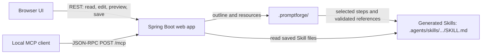

# PromptForge

PromptForge is a local web app for creating and managing agent Skills. Edit each Skill as a sequence of steps, choose which steps to include, preview the generated `SKILL.md`, and serve saved Skills to an AI client through a local MCP endpoint.

Every Skill uses the same step editor, including Skills imported from Markdown. Unselected steps stay in the management outline and are omitted from the generated Skill.

## Features

- Create Skills and manage multiple Skills in one workspace.
- Add, edit, reorder, and select steps in a shared editor.
- Edit optional text resources such as scripts and references, then attach them to steps.
- Preview generated output and protect saves with revision checks.
- Read saved Skills through a local, read-only MCP server. MCP does not execute scripts.

## Goals and boundaries

PromptForge keeps the complete, editable Skill outline in the workspace and generates an agent-facing `SKILL.md` from the steps the author selects. All Skills use the same step-based editing model, so imported Markdown can be extended without maintaining a separate document editor.

The app manages instructions and references; it does not run user scripts, install their runtimes, or execute the task described by a Skill. MCP exposes saved output for an agent to read. It is not a cloud-hosted service, and it does not establish that an agent followed the Skill correctly.

## Architecture



The `web` module serves the browser UI, Skill management APIs, generation preview, and MCP endpoint. The `workbench` module provides workspace file-boundary checks and revision-aware file storage. `.promptforge/` is the editable source; `.agents/skills/` contains generated or locally installed Skills. Saving checks the source revision and validates selected dependencies before updating generated output. The repository tracks the portable PromptForge Skill entry point; other local Skill files stay out of Git.

## Requirements

- Java 21
- Windows PowerShell for the helper scripts below

The build script uses the Java runtime bundled in `.tools` when it is present.

## Run locally

From the repository root, run:

```powershell
.\scripts\build-web.ps1
.\scripts\start-web.ps1
```

Open [http://127.0.0.1:8081/](http://127.0.0.1:8081/). The server binds to loopback and is available only on the same machine. Press `Ctrl+C` in the server terminal to stop it.

The build runs the backend and browser workflow tests. To skip only the browser workflow test:

```powershell
.\scripts\build-web.ps1 -SkipBrowser
```

## Manage Skills

1. In **Skill 庫**, choose an existing Skill or create one. Enter its purpose and, if useful, the kind of input it receives and the result it should produce.
2. Open **2 步驟**. Add or edit steps, reorder them, and select the steps to include for the agent. Newly added steps start unselected; select them to include them. Unselected steps remain in the outline.
3. To use supporting files, create or edit a text resource under **腳本與參考資料**, save it, then attach it to a step. PromptForge validates selected dependencies but does not run scripts or install runtimes.
4. Open **3 檢查並保存**, review the selected steps and generated preview, then save. The generated file is written to `.agents/skills/<name>/SKILL.md`. If the source changed since it was loaded, reload and reconcile the changes before saving.

## Connect through MCP

With the local server running, register its MCP endpoint with Codex CLI:

```powershell
codex mcp add promptforge --url http://127.0.0.1:8081/mcp
codex mcp list
```

Start a new agent session after changing MCP settings. The server provides these read-only tools:

- `list_skills` and `get_skill(name)` for the local Skill library
- `get_selected_skill`, `get_context_skill`, and `get_program_status` for the PromptForge workflow

The endpoint reads saved output. A reachable endpoint does not by itself prove that an agent has read a Skill; use the connection check in the web app to verify an actual MCP read. The loopback URL is for a client on the same machine, not a remote cloud agent.

Repo-scoped Skills such as `$PromptForge` are a separate way for a local agent session to discover Skills. Restart the session after changing generated files so the client can rediscover them.

## Local data and templates

Local authoring data stays out of Git, with the PromptForge Skill entry point as the deliberate exception:

| Path | Contents |
| --- | --- |
| `.promptforge/program.json` | PromptForge management outline |
| `.promptforge/outlines/` | Management outlines for other Skills |
| `.promptforge/resources/<name>/` | Text resources attached to Skills |
| `.agents/skills/<name>/SKILL.md` | Generated or locally installed Skills |
| `.agents/skills/PromptForge/SKILL.md` | Portable PromptForge Skill instructions tracked in this repository |

On a fresh checkout, initialize the two starter outlines with:

```powershell
.\scripts\init-local-data.ps1
```

The script preserves existing local files and creates only missing outlines. The reusable outline template and its schema are in `templates/outline-v1.json` and `templates/outline-v1.schema.json`.

For implementation history and detailed verification notes, see [the September 2026 program record](docs/2026-09-program.md).
